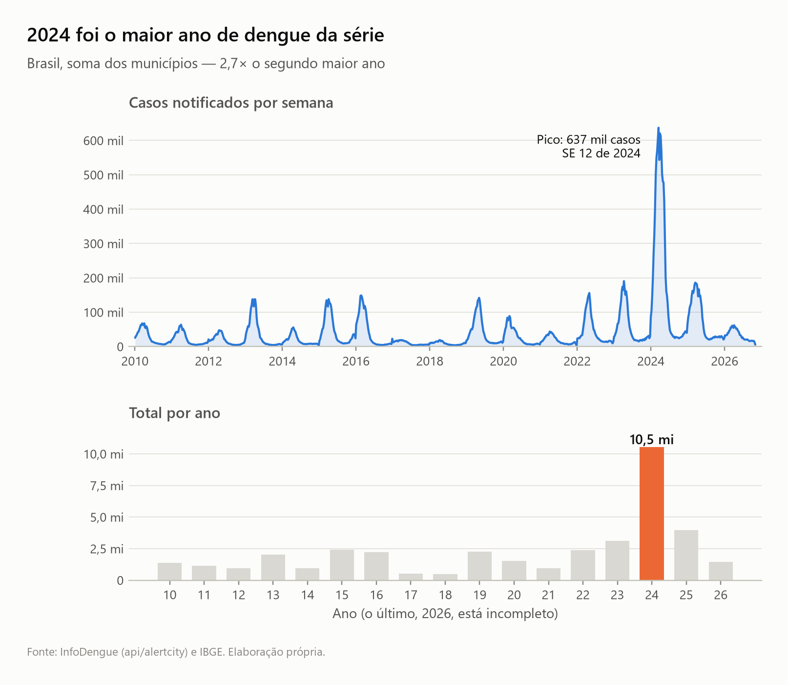
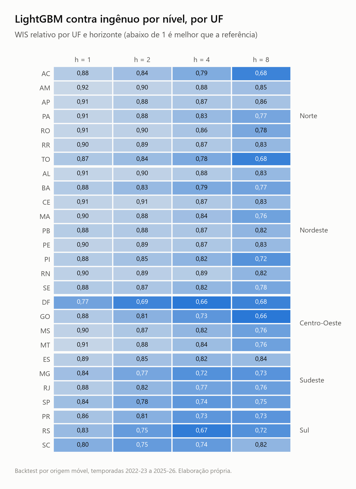
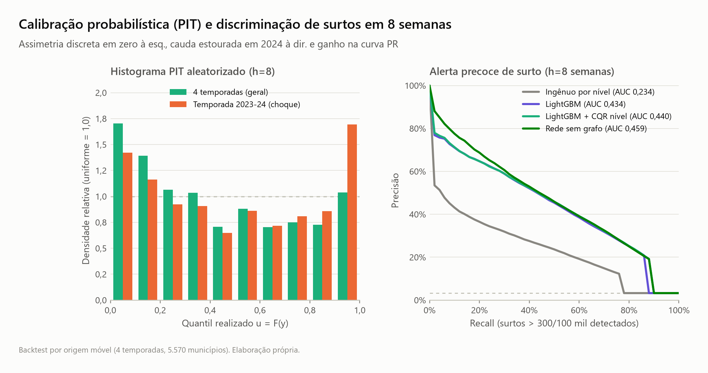
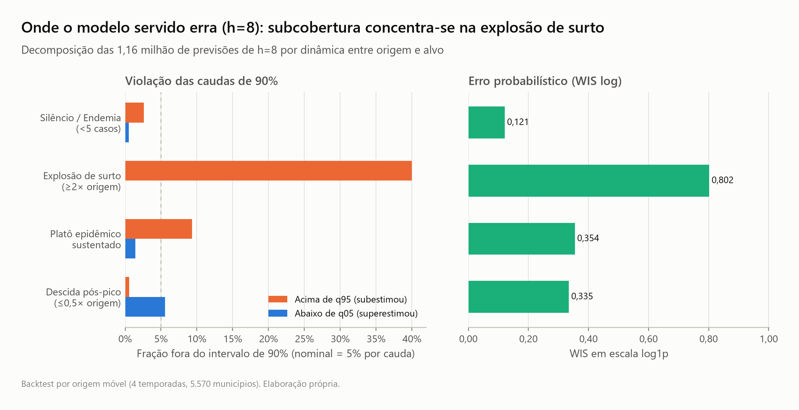
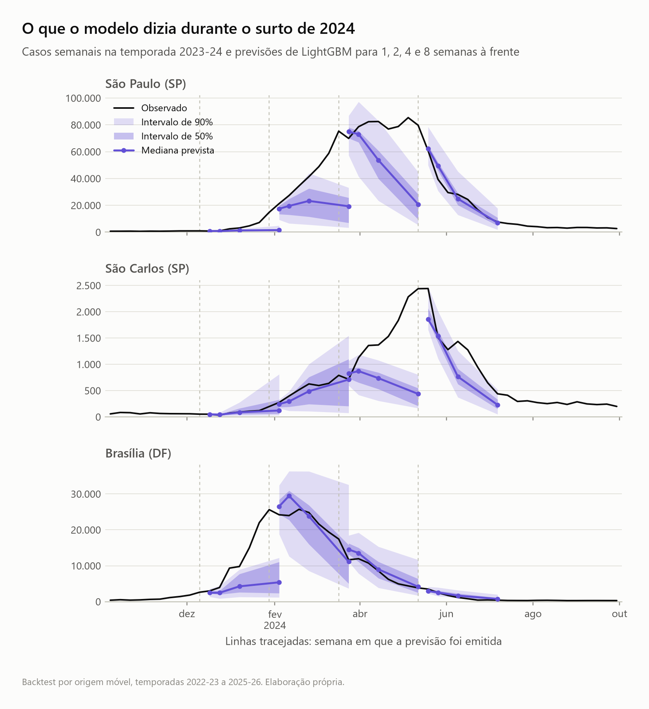
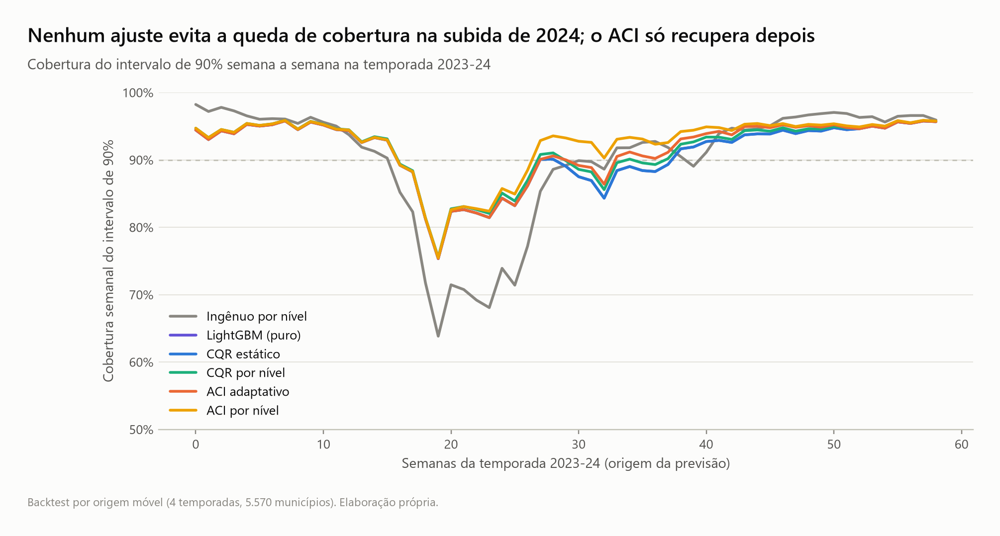
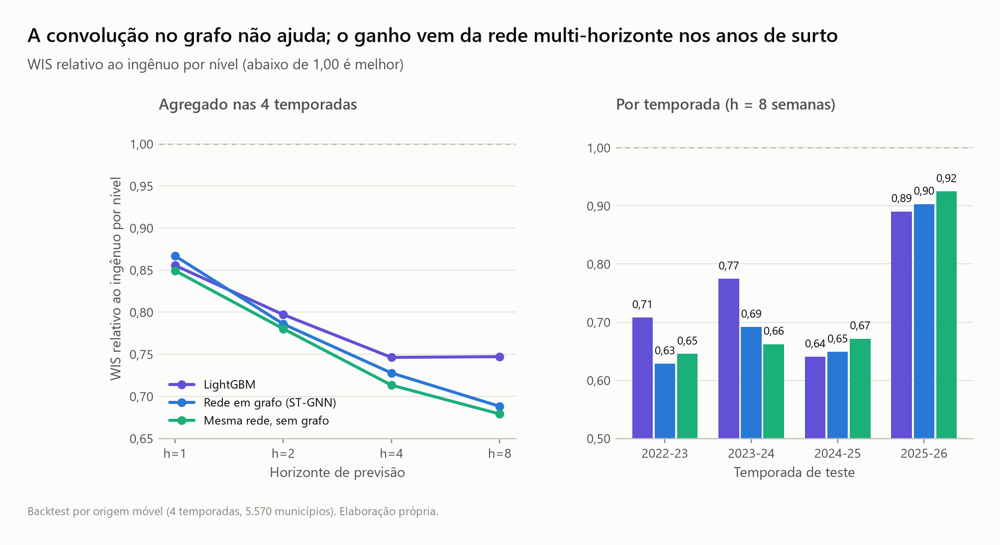

# dengue-forecast-br

**Previsão probabilística semanal de casos de dengue para os 5.570 municípios brasileiros**, com calibração conformal estratificada, avaliação temporal anti-vazamento e plataforma interativa de exploração espacial e diagnóstico.

Especificação original do projeto em [SPEC.md](SPEC.md). **Aplicação interativa ao vivo**: [**pedrohbenetton.github.io/dengue-forecast-br**](https://pedrohbenetton.github.io/dengue-forecast-br/).
Relatórios técnicos detalhados por etapa: [EDA](reports/eda.md) · [Fase 1 (Baselines)](reports/fase1.md) · [Fase 2 (LightGBM)](reports/fase2.md) · [Fase 3 (Conformal)](reports/fase3.md) · [Fase 4 (ST-GNN)](reports/fase4.md) · [Fase 6 (DENV-3)](reports/fase6.md).

[](https://github.com/pedrohbenetton/dengue-forecast-br/actions/workflows/ci.yml)
[](https://pedrohbenetton.github.io/dengue-forecast-br/)
[](LICENSE)
[](.python-version)
[](web/)

---

## Resumo (Abstract)

Iniciativas consolidadas de previsão de dengue no Brasil, como o desafio Infodengue-Mosqlimate (IMDC), operam majoritariamente no nível estadual. Este trabalho investiga e operacionaliza a previsão probabilística semanal **em escala municipal completa** (5.570 municípios com histórico no InfoDengue), emitindo nove quantis preditivos nos horizontes $h \in \{1, 2, 4, 8\}$ semanas à frente. Avaliado em protocolo rigoroso de origem móvel (*rolling origin* com janela expansiva) ao longo de quatro temporadas epidemiológicas completas (2022–23 a 2025–26, totalizando **4.656.520 previsões por modelo**), um modelo global **LightGBM quantílico** sobre variações logarítmicas supera o melhor baseline probabilístico (*persistência estratificada por patamar de casos*) em **todos os horizontes, faixas populacionais, macrorregiões e nas 27 UFs**, reduzindo o *Weighted Interval Score* (WIS) de 14% ($h=1$) a 27% ($h=8$, após calibração conformal por nível) e elevando o PR-AUC de alerta precoce de surtos ($>300$ casos/100 mil hab. em 8 semanas) de **0,235 para 0,440**. Experimentos controlados adicionais demonstram resultados negativos informativos: convoluções em grafo municipal (ST-GNN), inferência conformal adaptativa (ACI) em horizonte longo, anomalias climáticas defasadas e proxies macro de dívida imunológica sem sorotipagem laboratorial não superam de forma consistente a combinação enxuta de histórico próprio, sazonalidade municipal e calibração conformal estratificada por nível de atividade.

---

## 1. Dados e Desafios Estruturais em Escala Municipal

O painel consolidado (`dengue_forecast.panel`) integra as séries públicas da API `alertcity` do InfoDengue (SE 01/2010 a SE 44/2026, 879 semanas, 4,90 milhões de registros) às malhas e estimativas populacionais do IBGE:

1. **Inflação extrema de zeros nos municípios pequenos**: 69% dos municípios brasileiros têm menos de 20 mil habitantes; abaixo de 5 mil habitantes, **86% das semanas têm zero casos** (contra 3% acima de 500 mil hab.). Médias nacionais não estratificadas misturam zeros triviais com metrópoles que determinam a escala absoluta do erro.
2. **Defasagem sazonal entre regiões**: O pico epidêmico ocorre em fevereiro no Norte, março–abril no Centro-Oeste/Sudeste/Sul e maio no Nordeste, inviabilizando climatologias nacionais únicas.
3. **Choque fora de escala em 2023–24**: Em 2024 o país registrou 10,5 milhões de notificações (2,7× o segundo maior ano da série, com pico de 637 mil notificações na SE 12), exigindo extrapolação acima do suporte histórico de treino.
4. **Atraso de digitação e degrau na virada do ano**: Na data de coleta, a semana mais recente continha apenas 29% dos casos estimados pelo *nowcast* (`casos_est`), atingindo 95% apenas cinco semanas para trás. Além disso, o fechamento anual do SINAN introduz um salto sistemático entre a SE 52 e a SE 01 em todas as regiões.



---

## 2. Protocolo de Avaliação e Família de Modelos

* **Temporadas de teste**: `2022-23`, `2023-24` (recorde histórico), `2024-25` e `2025-26` (SE 41 do ano $Y-1$ à SE 40 do ano $Y$). A temporada `2021-22` é reservada exclusivamente para seleção de hiperparâmetros e calibração inicial.
* **Garantia anti-vazamento**: Para cada temporada o modelo é ajustado uma vez com o painel truncado na véspera da temporada; para cada semana de origem $t$, `predict()` recebe o painel truncado em $t$ (testado automaticamente por mutação adversarial do futuro em `tests/`). Campos sujeitos a revisão retrospectiva na API (`Rt`, alertas revisados) são banidos das features.
* **Alvo em variação logarítmica**: Tanto o LightGBM quanto as redes neurais preveem $\Delta_{i,t,h} = \log(1 + y_{i, t+h}) - \log(1 + y_{i, t})$ nos 9 quantis $\{0.025, 0.05, 0.1, 0.25, 0.5, 0.75, 0.9, 0.95, 0.975\}$, permitindo acompanhar surtos inéditos em escala absoluta.

---

## 3. Resultados Comparativos

### 3.1. Ranking Geral nas 4 Temporadas de Teste (4.656.520 previsões/modelo)

Todos os valores abaixo são extraídos diretamente dos CSVs em [`reports/`](reports/):

| Modelo | Fase | WIS h=1 | WIS h=2 | WIS h=4 | WIS h=8 | WIS rel. h=8 | Cob. 50% (méd.) | Cob. 90% (méd.) | PR-AUC Surto (h=8) |
|---|---|---|---|---|---|---|---|---|---|
| Sazonal (mesma SE do ano anterior) | 1 | 15,66 | 15,66 | 15,66 | 15,66 | 1,820× | 50,8% | 84,2% | 0,086 |
| Média histórica por SE | 1 | 10,65 | 10,65 | 10,65 | 10,65 | 1,237× | 68,1% | 84,8% | 0,100 |
| Ingênuo (última semana, por porte) | 1 | 2,66 | 3,68 | 5,86 | 10,53 | 1,223× | 53,4% | 87,4% | 0,218 |
| **Ingênuo por nível de casos (referência)** | 2 | 2,10 | 3,17 | 5,15 | 8,61 | **1,000×** | 71,0% | 93,0% | 0,235 |
| LightGBM global quantílico (42 features) | 2 | 1,80 | 2,53 | 3,84 | 6,43 | 0,747× | 66,0% | 93,1% | 0,434 |
| LightGBM + CQR estático por horizonte | 3 | 1,80 | 2,53 | 3,84 | 6,45 | 0,749× | 66,0% | 93,2% | 0,434 |
| **LightGBM + CQR por nível (servido)** | **3** | **1,80** | **2,53** | **3,80** | **6,30** | **0,731×** | **67,2%** | **93,5%** | **0,440** |
| LightGBM + ACI adaptativo por horizonte | 3 | 1,80 | 2,53 | 3,84 | 7,17 | 0,833× | 63,6% | 93,3% | 0,436 |
| LightGBM + ACI adaptativo por nível | 3 | 1,80 | 2,50 | 3,95 | 6,52 | 0,757× | 64,1% | 93,5% | 0,440 |
| LightGBM + dívida imunológica (DENV-3) | 6 | 1,80 | 2,53 | 3,84 | 6,47 | 0,752× | 65,7% | 93,0% | 0,426 |
| Rede em grafo espaço-temporal (ST-GNN) | 4 | 1,82 | 2,49 | 3,75 | 5,92 | 0,688× | 59,7% | 92,8% | 0,467 |
| Mesma rede neural, sem grafo (`A = 0`) | 4 | 1,79 | 2,47 | 3,67 | 5,85 | 0,679× | 59,7% | 92,9% | 0,459 |

### 3.2. Avaliação Estratificada em $h=8$ (WIS relativo ao `naive_level` | Cobertura 90%)

| Estrato | `naive` | `naive_level` | `lgbm` | `lgbm_cqr_level` (servido) | `lgbm_immunity` | `gnn` | `gnn_nograph` |
|---|---|---|---|---|---|---|---|
| **Porte: < 5 mil hab.** | 1,44× (83%) | 1,00× (95%) | 0,78× (94%) | **0,78× (95%)** | 0,78× (94%) | 0,76× (94%) | 0,76× (94%) |
| **Porte: 5–20 mil hab.** | 1,29× (84%) | 1,00× (93%) | 0,78× (92%) | **0,77× (93%)** | 0,78× (92%) | 0,76× (92%) | 0,75× (92%) |
| **Porte: 20–100 mil hab.** | 1,22× (86%) | 1,00× (91%) | 0,74× (90%) | **0,73× (92%)** | 0,75× (90%) | 0,72× (90%) | 0,71× (90%) |
| **Porte: 100–500 mil hab.** | 1,23× (88%) | 1,00× (89%) | 0,71× (88%) | **0,70× (91%)** | 0,72× (88%) | 0,65× (88%) | 0,65× (89%) |
| **Porte: > 500 mil hab.** | 1,16× (90%) | 1,00× (90%) | 0,77× (90%) | **0,74× (93%)** | 0,77× (91%) | 0,66× (91%) | 0,64× (92%) |
| **Temp.: 2022–23** | 1,22× (86%) | 1,00× (93%) | 0,71× (93%) | **0,69× (94%)** | 0,70× (93%) | 0,63× (93%) | 0,65× (93%) |
| **Temp.: 2023–24 (recorde)** | 1,22× (73%) | 1,00× (86%) | 0,77× (87%) | **0,74× (88%)** | 0,78× (87%) | 0,69× (87%) | 0,66× (88%) |
| **Temp.: 2024–25** | 1,23× (87%) | 1,00× (94%) | 0,64× (94%) | **0,69× (95%)** | 0,64× (94%) | 0,65× (93%) | 0,67× (93%) |
| **Temp.: 2025–26** | 1,21× (93%) | 1,00× (97%) | 0,89× (94%) | **0,89× (94%)** | **0,86× (95%)** | 0,90× (93%) | 0,92× (93%) |



### 3.3. Calibração (PIT), Discriminação de Surtos (Curvas PR) e Decomposição de Erros

O histograma de *Probability Integral Transform* (PIT aleatorizado invariante a escala) revela duas assinaturas estruturais claras em $h=8$: à esquerda ($u < 0,2$), o excesso de massa vem de semanas com zero casos observados nas quais os quantis contínuos previstos ficam positivos ($0 < \hat{q} < 1$); à direita ($u \in [0,9, 1,0]$), o pico acentuado na temporada **2023–24** quantifica as semanas de explosão epidêmica em que os casos observados romperam o teto de 95% previsto:



Separando as 1,16 milhão de previsões de $h=8$ do modelo servido por regime epidemiológico observado entre origem e alvo, evidencia-se que a subcobertura acima de `q0.95` é rara no regime silencioso, mas domina as transições abruptas de início de surto ($\ge 2\times$ os casos da origem):





---

## 4. O Que Não Funcionou (Resultados Negativos Documentados)

Seguindo a diretriz científica do projeto ([SPEC.md](SPEC.md)), cinco hipóteses plausíveis falharam ou trouxeram retorno nulo no backtest rigoroso:

1. **Anomalias climáticas defasadas não acrescentam poder preditivo sobre a sazonalidade ([Fase 2](reports/fase2.md))**: Somar temperatura e umidade defasadas (`lgbm_nb` $\to$ `lgbm`) moveu o WIS relativo em $h=8$ de `0,740` para `0,747` e recebeu menos de `0,2%` do ganho das árvores. O ciclo sazonal anual municipal (`tw_sin`, `tw_cos`, `clim`) já absorve quase todo o efeito climático médio nessa janela.
2. **CQR global por horizonte colapsa por causa dos zeros ([Fase 3](reports/fase3.md))**: Como 48% a 64% das linhas de calibração têm $y=0$ e quantil inferior zero, o escore de conformidade empata em `0` e o quantil 90% da margem global vira exatamente zero. Somente estratificar o CQR pelo **nível de casos na origem** (`lgbm_cqr_level`) destrava o ajuste nas cidades ativas, elevando a cobertura de 90% na faixa de 100–500 mil hab. de `87,8%` para `90,8%` e reduzindo o WIS em $h=8$ de `6,43` para `6,30`.
3. **Inferência Conformal Adaptativa (ACI) degrada o horizonte longo ([Fase 3](reports/fase3.md))**: Em $h=8$, o erro só é revelado 8 semanas após a emissão. Durante a subida de 2024, o parâmetro adaptativo $\alpha_{\mathrm{eff}}$ continua caindo quando o pico já passou, gerando intervalos excessivamente largos na descida e elevando o WIS de 2023–24 de `15,84` para `18,78`.
4. **Convolução espacial em grafo não supera a mesma rede sem grafo ([Fase 4](reports/fase4.md))**: Treinada na RTX 2060 sobre a matriz de adjacência municipal do IBGE, a `STGNN` perdeu ou empatou com o controle idêntico `gnn_nograph` ($\mathbf{\hat{A}} = \mathbf{0}$) em todos os horizontes (`WIS h=8`: `5,92` vs `5,85`). A vantagem de ~9% em $h=8$ sobre o LightGBM vem do decodificador neural multi-horizonte conjunto durante o choque de 2023–24, e não da difusão em grafo; nas temporadas calmas (2024–25 e 2025–26), o LightGBM empata ou vence.
5. **Proxies macro de dívida imunológica não antecipam trocas de sorotipo ([Fase 6](reports/fase6.md))**: Quatro features causais de calmaria plurianual (`quiet_ratio`, `immune_debt`, `reemergence_boost`, `susceptible_gap`) não melhoraram a previsão na entrada do DENV-3 em 2023–24 (`WIS h=8`: `16,05` vs `15,84`; `PR-AUC`: `0,426` vs `0,434`), pois notificações totais sem PCR confundem epidemias recentes de DENV-1/DENV-2 com proteção imunológica. O sinal só gerou ganho real na retração pós-epidêmica de **2025–26** (`WIS h=8`: `2,05` $\to$ `1,99`, `-2,9%`), quando houve esgotamento efetivo de suscetíveis após 2024.





---

## 5. Plataforma Web Interativa e Operação Semanal

A aplicação estática em [`web/`](web/) (TypeScript + Vite + MapLibre GL JS, publicada via GitHub Pages sem backend) consome exclusivamente artefatos binários e JSON gerados por `dengue_forecast.export`:

* **Mapa coroplético animado dos 5.570 municípios** (malha IBGE em TopoJSON, 1,4 MB) com controle semanal de reprodução nas 209 semanas-alvo do backtest e quatro camadas: *Casos Observados*, *Previsão Mediana*, *Probabilidade de Surto ($>300/100\text{k}$)* e **Mapa de Resíduos** em escala logarítmica divergente.
* **Drill-down municipal em dois modos**: *Série por horizonte fixo* e **O que o modelo dizia na época** (cone multi-horizonte $h \in \{1, 2, 4, 8\}$ projetado a partir da semana selecionada no slider sobre a trajetória futura observada), além da tabela de previsão operacional ao vivo (`live.json`).
* **Painel de Avaliação interativo**: ranking completo dos 12 modelos, explorador estratificado (porte, temporada, região e virada do ano), heatmap de skill nas 27 UFs, diagrama de calibração + cobertura semanal em 2024, histograma PIT aleatorizado e curvas Precisão–Recall por horizonte.
* **Aba de Análise de Erro**: decomposição quantitativa por regime epidemiológico e atalhos diretos para inspecionar semanas críticas no mapa de resíduos.
* **Automação semanal (`.github/workflows/weekly.yml`)**: toda segunda-feira atualiza os dados do InfoDengue incrementalmente, ajusta o LightGBM excluindo as 4 semanas incompletas, aplica o *nowcast* (`casos_est`) na origem mais recente, calibra os intervalos com `margens_cqr_nivel.csv` e republica o site.

---

## 6. Instalação e Reprodução

O projeto utiliza [`uv`](https://docs.astral.sh/uv/) (Python 3.12) e Node.js 22+ para o frontend:

```bash
# 1. Clonar e instalar dependências (adicione --group gnn para PyTorch + CUDA 12.4)
git clone https://github.com/pedrohbenetton/dengue-forecast-br.git
cd dengue-forecast-br
uv sync --group gnn

# 2. Suíte de testes automatizados (160+ testes, sem rede) e lint
uv run --group gnn pytest -q
uv run ruff check

# 3. Reproduzir TODO o pipeline de ponta a ponta em um único comando (SPEC.md)
uv run --group gnn python -m dengue_forecast.reproduce

# (Se data/raw já estiver em cache local e quiser pular nova consulta à API)
uv run --group gnn python -m dengue_forecast.reproduce --skip-download

# 4. Empacotar histórico publicado pelo CI (inclui live.json inicial) e compilar a aplicação web
tar -czf site/history.tar.gz -C web/public/data .
cd web && npm ci && npm run typecheck && npm run build
```

---

## Fontes de Dados & Licença

* **[InfoDengue](https://info.dengue.mat.br)** (`api/alertcity`): notificações semanais, estimativas de *nowcasting* (`casos_est`), população e séries meteorológicas municipais.
* **[IBGE Localidades e Malhas](https://servicodados.ibge.gov.br)**: hierarquia regional e malha municipal simplificada em TopoJSON.

A pasta `data/` (brutos, painel consolidado e parquets do backtest) permanece fora do versionamento Git (`.gitignore`) e é integralmente regenerável via `dengue_forecast.reproduce`. Distribuído sob a licença [MIT](LICENSE).
