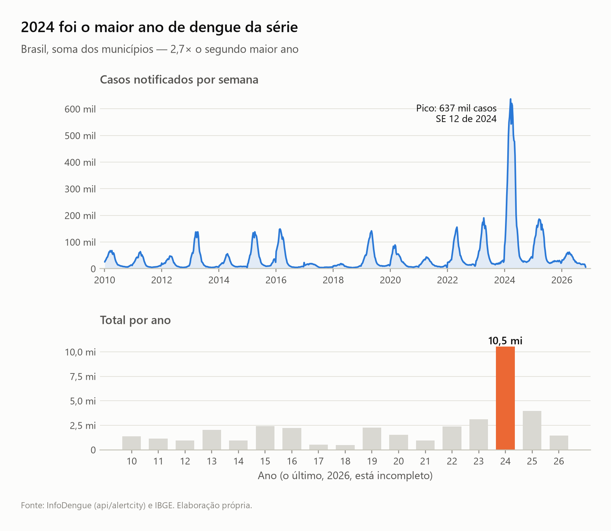

# dengue-forecast-br

Previsão probabilística semanal de casos de dengue para os ~5.570 municípios brasileiros, com
intervalos calibrados e avaliação temporal honesta. Especificação completa em [SPEC.md](SPEC.md).

**Status:** fase 0 concluída (ingestão, painel, [EDA](reports/eda.md)). Este README vira um
paper curto ao final (fase 7).



## Uso

```bash
uv sync
uv run pytest -q
uv run ruff check

uv run python -m dengue_forecast.download   # ~12 min, retomável; --refresh-years 2 para atualizar
uv run python -m dengue_forecast.panel      # data/processed/panel.parquet
uv run python -m dengue_forecast.eda        # reports/figures/*.png
```

## Dados

- [InfoDengue](https://info.dengue.mat.br) `api/alertcity` — casos, nowcast, Rt, clima.
- [IBGE localidades](https://servicodados.ibge.gov.br/api/docs/localidades) — municípios.

`data/` não é versionado; tudo é reproduzível a partir das APIs públicas.
