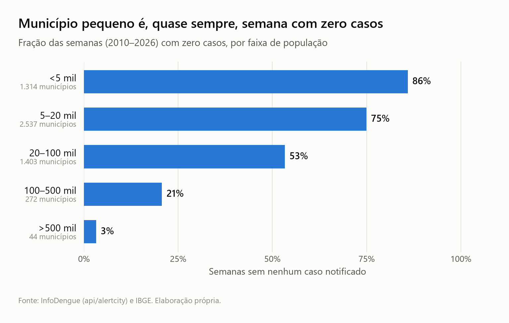
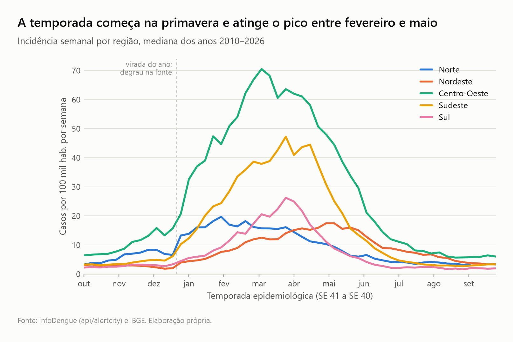
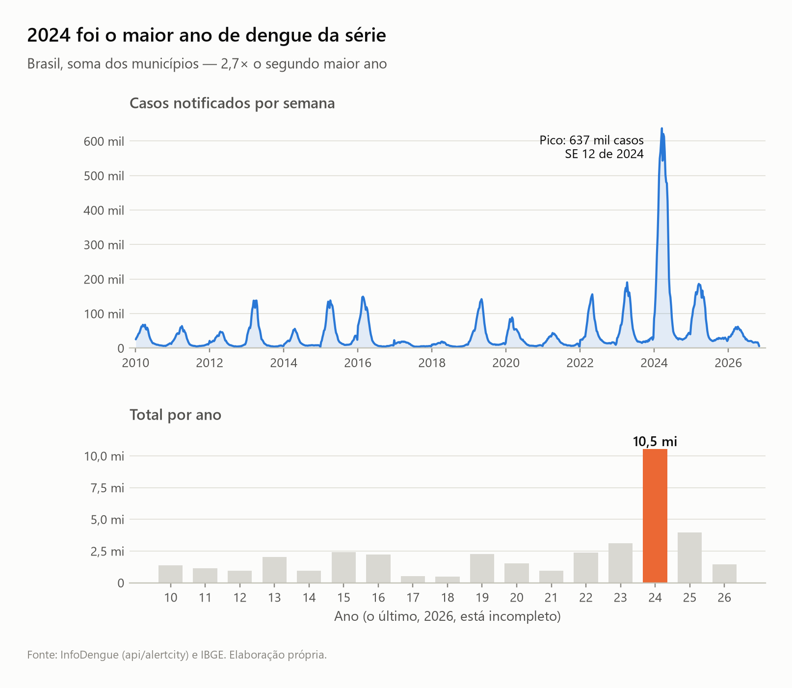
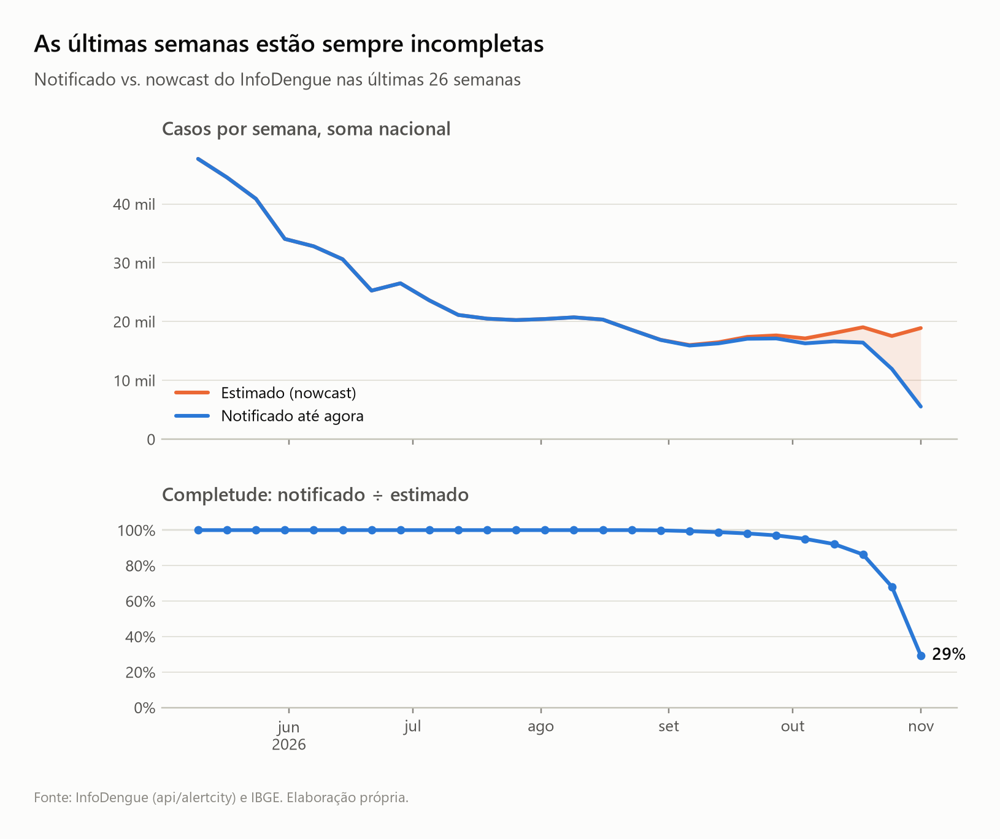

# EDA — fase 0

Dados baixados em 2026-11-11: 5.571 municípios (lista do IBGE), SE 01/2010 a SE 44/2026,
879 semanas, 4.896.030 linhas. Reproduzir:

```bash
uv run python -m dengue_forecast.download
uv run python -m dengue_forecast.panel
uv run python -m dengue_forecast.eda
```

## Integridade

- Chave (geocode, epiweek) única; nenhum município com semanas faltando; sem casos negativos
  nem nulos em `cases` e `population`.
- 1 município sem dados: Boa Esperança do Norte (MT, 5101837), instalado em 2025; a API devolve
  série vazia.
- `cases_conf` e `cases_prob_est*` vêm 100% vazios nos municípios inspecionados; não usar.

## Achados que afetam a modelagem

### 1. Zeros dominam os municípios pequenos



86% das semanas dos municípios com menos de 5 mil habitantes têm zero casos; acima de 500 mil,
3%. Os 3.851 municípios com menos de 20 mil habitantes são 69% do total. Consequência: métrica
média nacional é dominada por zeros triviais, e por isso a avaliação é estratificada por porte.

### 2. Sazonalidade forte, com defasagem entre regiões



O Norte atinge o pico em fevereiro; Centro-Oeste, Sudeste e Sul entre março e abril; o Nordeste
em maio. Um baseline sazonal precisa ser por município (ou ao menos por região), não nacional.

### 3. 2024 é um ponto fora da curva



10,5 milhões de notificações em 2024, 2,7 vezes o segundo maior ano (2025, 4,0 milhões); pico
de 637 mil casos na SE 12. A temporada de teste 2023-24 exige extrapolar muito além de tudo que
está no treino — é o teste mais duro do backtest. (`casos` conta notificações, por isso o total
supera o número oficial de casos prováveis.)

### 4. As últimas semanas estão incompletas



Na data do download, a semana mais recente tinha 29% do total estimado pelo nowcast, a anterior
68%, e a completude só chega a 95% na quinta semana para trás. Usar `cases` cru como
última observação na previsão ao vivo subestimaria sistematicamente; daí o uso de `cases_est`.

### 5. Degrau na virada do ano (artefato da fonte)

Em quase todos os anos a série nacional salta entre a última SE de um ano e a SE 01 do seguinte
(SE 52/2021: 3.162 casos; SE 01/2022: 23.577. SE 52/2023: 29.818; SE 01/2024: 85.547). O padrão
aparece em todas as regiões e não parece epidemiológico; a causa não foi investigada (hipótese:
fechamento anual das bases do SINAN). Impacto: lags e o baseline "última semana" ficam enviesados
nas origens de dezembro e janeiro. A fase 1 deve reportar o erro dessas semanas em separado.
