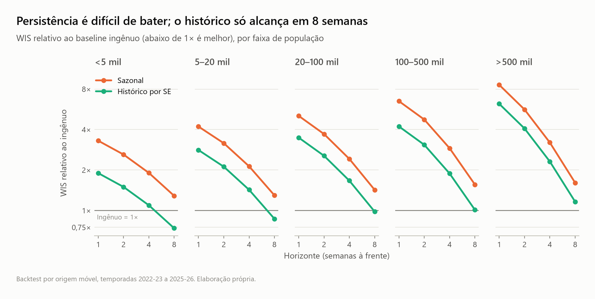
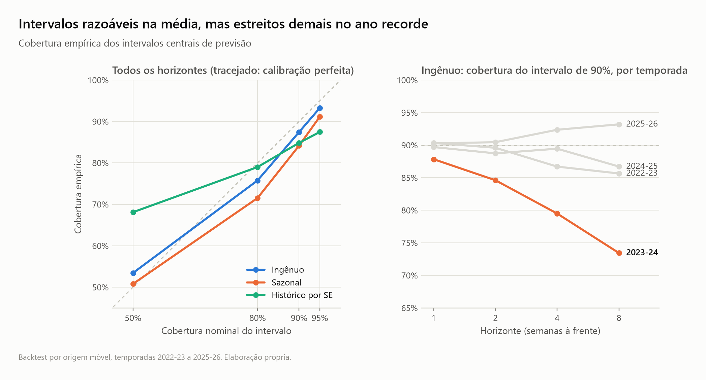

# Fase 1 — harness de avaliação e baselines

Reproduzir (53 s em CPU, a partir do painel da fase 0):

```bash
uv run python -m dengue_forecast.backtest          # previsões, métricas e tabelas
uv run python -m dengue_forecast.viz.evaluation    # figuras
```

Tabelas completas em [`fase1/`](fase1/) (CSV por horizonte, faixa, região, temporada, virada do
ano e alerta).

## Protocolo

- Temporadas de teste: 2022-23, 2023-24, 2024-25 e 2025-26 (SE 41 a SE 40).
- Pontua-se **pelo alvo**: toda semana-alvo da temporada recebe previsão nos horizontes 1, 2, 4
  e 8, então todos os horizontes são avaliados nas mesmas semanas. São 5.570 municípios e
  4.656.520 previsões por modelo.
- Para cada temporada o modelo é ajustado com o painel truncado na véspera da temporada; para
  cada origem `t`, recebe o painel truncado em `t`. O harness nunca entrega o futuro ao modelo,
  e um teste verifica que alterar os dados posteriores a `t` não muda a previsão feita em `t`.
- Verdade: `cases` consolidado (limitação descrita no SPEC: é otimista quanto ao atraso de
  notificação).
- Alerta: incidência no alvo acima de 300/100 mil, com a população conhecida na origem.

## Baselines

| Modelo | Previsão pontual | Incerteza |
|---|---|---|
| Ingênuo | último valor observado | quantis dos erros de persistência em escala log, por faixa de população e horizonte, medidos no treino |
| Sazonal | valor de 52 semanas antes do alvo | quantis dos erros sazonais em escala log, por faixa de população |
| Histórico por SE | — | quantis empíricos da mesma SE (±1) nos anos anteriores do município |

## Resultados

### Por horizonte (todas as temporadas e municípios)

| Modelo | h | WIS | WIS rel. | WIS log rel. | MAE | Cob. 50% | Cob. 90% | PR-AUC alerta |
|---|---|---|---|---|---|---|---|---|
| Ingênuo | 1 | 2,66 | 1,00 | 1,00 | 4,15 | 54,7% | 89,5% | 0,848 |
| Ingênuo | 2 | 3,68 | 1,00 | 1,00 | 6,20 | 53,9% | 88,4% | 0,746 |
| Ingênuo | 4 | 5,86 | 1,00 | 1,00 | 10,00 | 53,0% | 87,0% | 0,554 |
| Ingênuo | 8 | 10,53 | 1,00 | 1,00 | 16,44 | 52,1% | 84,8% | 0,218 |
| Sazonal | 1 | 15,66 | 5,90 | 2,37 | 20,90 | 50,8% | 84,2% | 0,086 |
| Sazonal | 8 | 15,66 | 1,49 | 1,21 | 20,90 | 50,8% | 84,2% | 0,086 |
| Histórico por SE | 1 | 10,65 | 4,01 | 1,98 | 14,79 | 68,1% | 84,8% | 0,100 |
| Histórico por SE | 8 | 10,65 | 1,01 | 1,01 | 14,79 | 68,1% | 84,8% | 0,099 |

O sazonal e o histórico não dependem da origem, por isso têm o mesmo erro em todos os
horizontes. A prevalência do evento de alerta é 3,3% das previsões.

### Por faixa de população



- A persistência domina no curto prazo em todos os portes, e a vantagem cresce com o tamanho do
  município: em h=1 o histórico tem WIS 1,9 vezes o do ingênuo abaixo de 5 mil habitantes e 6,2
  vezes acima de 500 mil.
- Em h=8 o histórico **vence** o ingênuo nos municípios pequenos (0,74 abaixo de 5 mil; 0,87
  entre 5 e 20 mil), empata entre 20 e 500 mil e perde acima de 500 mil (1,16).
- O WIS absoluto cresce duas ordens de grandeza com o porte (ingênuo, h=1: 0,60 abaixo de 5 mil
  e 64,9 acima de 500 mil), o que confirma que a média nacional é dominada pelas cidades grandes.
  O WIS em escala log reduz essa distorção.

### Calibração



- O ingênuo é o mais bem calibrado, mas seus intervalos de 90% ficam estreitos quando o horizonte
  cresce (89,5% em h=1, 84,8% em h=8).
- Em 2023-24 (ano recorde) a cobertura de 90% do ingênuo cai a 73,4% em h=8: os erros do passado
  não anteciparam a escala do surto. Em 2025-26, temporada fraca, os intervalos ficam largos
  demais (93,2%).
- O histórico por SE cobre demais no centro (68% no intervalo de 50%) e de menos nas caudas
  (87,5% no de 95%).

### Por temporada

WIS relativo ao ingênuo em h=8: histórico 0,87 (2022-23), 1,07 (2023-24), 0,91 (2024-25) e 1,11
(2025-26). O sazonal vai muito mal em 2024-25 e 2025-26 (3,2 vezes o ingênuo em h=8), porque
repete o ano recorde como previsão.

### Virada do ano

Previsões do ingênuo cuja origem e alvo caem em anos diferentes têm WIS log 22% a 28% maior e
cobertura de 90% entre 82% e 85%, contra 85% a 90% nas demais. O degrau da fonte na virada do ano
(ver [EDA](eda.md)) é mensurável e fica reportado em separado em `fase1/virada_do_ano.csv`.

### Alerta de surto

O PR-AUC do ingênuo cai de 0,85 em h=1 para 0,22 em h=8, e é pior nos municípios pequenos (0,78
abaixo de 5 mil contra 0,97 acima de 500 mil em h=1). Sazonal e histórico ficam em torno de 0,09
a 0,10, pouco acima da prevalência.

## O que isso define para a fase 2

1. A barra a superar é o ingênuo em h ≤ 4 e o melhor entre ingênuo e histórico em h=8.
2. O ganho mais provável está no horizonte longo e na antecipação de surtos (PR-AUC 0,22 em h=8).
3. A calibração precisa se adaptar ao regime: intervalos fixos por faixa falham no ano recorde.
   É o que a calibração conformal da fase 3 deve atacar.
4. A virada do ano precisa de tratamento explícito nas features.

## Limitações desta fase

- A incerteza do ingênuo e do sazonal é estratificada só por faixa de população; estratificar
  também pelo nível recente de casos provavelmente daria um baseline mais forte.
- O sazonal usa defasagem fixa de 52 semanas, que desliza uma semana em anos de 53.
- A SE 40/2026, última da temporada 2025-26, tinha 95% de completude na data do download.
