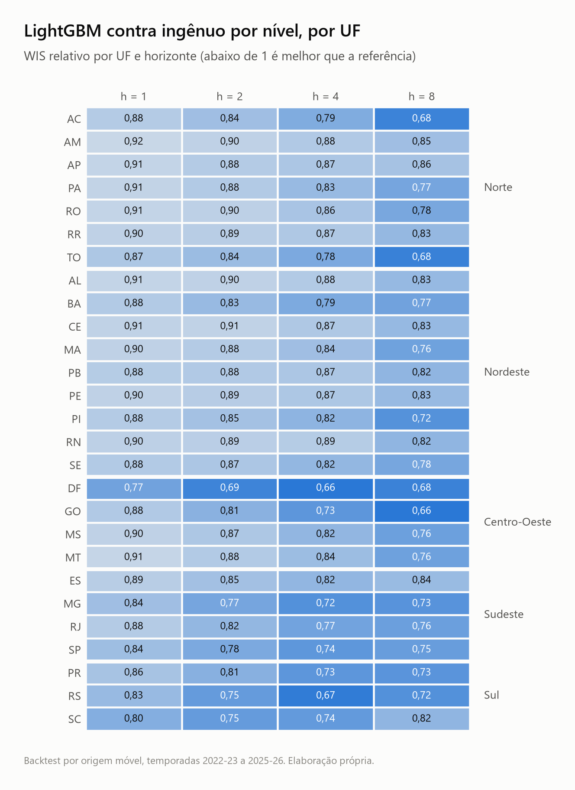
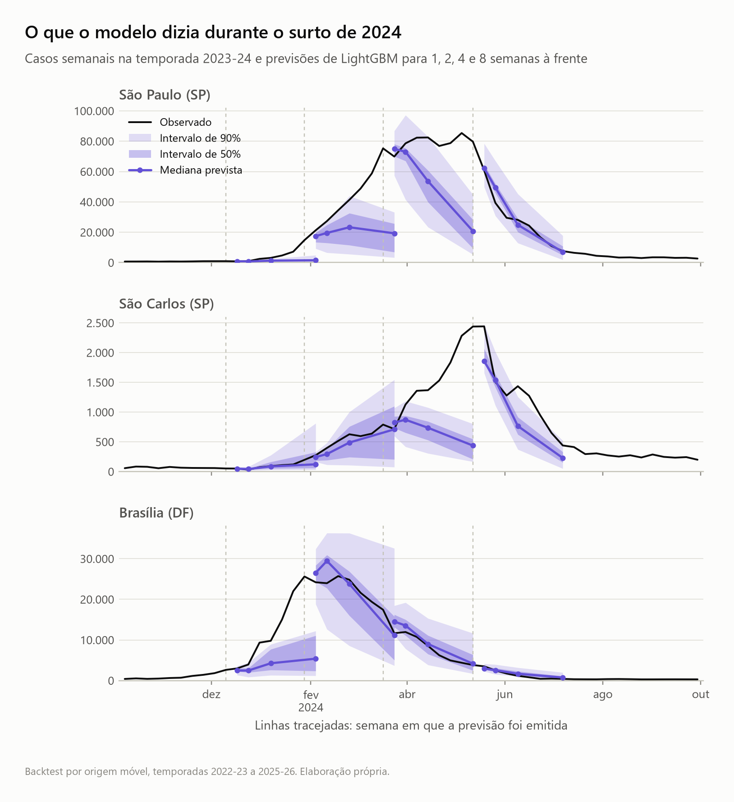
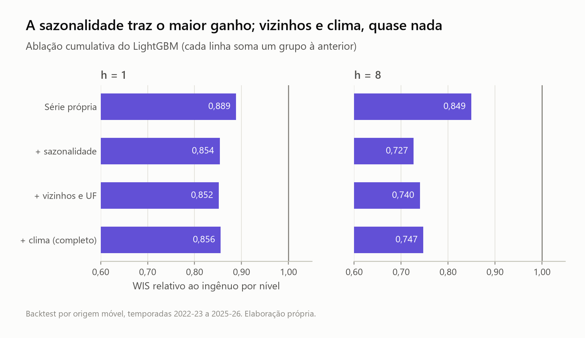
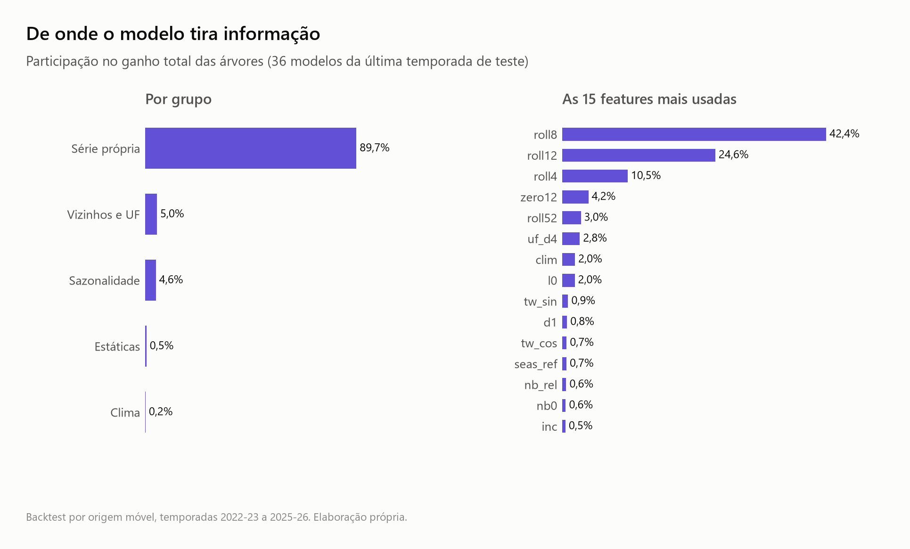

# Fase 2 — LightGBM global quantílico

Reproduzir (a partir do painel da fase 0; o backtest do LightGBM leva da ordem de uma hora em
CPU com 12 núcleos, não cronometrado com precisão):

```bash
uv run python -m dengue_forecast.tune        # grade de hiperparâmetros na validação 2021-22
uv run python -m dengue_forecast.backtest --models naive,naive_level,seasonal,climatology,lgbm \
    --out-dir reports/fase2 --reference naive_level
uv run python -m dengue_forecast.backtest --models lgbm_own,lgbm_season,lgbm_nb \
    --horizons 1,8 --forecast-dir data/forecasts/ablation
uv run python -m dengue_forecast.viz.phase2
```

Tabelas completas em [`fase2/`](fase2/).

## Resumo

Um único LightGBM para os 5.570 municípios supera o melhor baseline em **todos** os horizontes,
faixas de população, regiões, temporadas e UFs. O WIS cai de 14% (h=1) a 25% (h=4 e h=8), e o
PR-AUC do alerta de surto em 8 semanas vai de 0,23 para 0,43. A sazonalidade é a fonte do ganho
no horizonte longo; vizinhos e clima não acrescentaram nada mensurável.

## Modelo

- **Alvo**: variação em escala log entre a origem e t+h (`log1p(y[t+h]) − log1p(y[t])`), e não o
  nível de casos. Árvores não extrapolam além do treino, e 2023-24 exige isso.
- **Um modelo por (horizonte, quantil)**: 36 modelos por temporada, com os quantis ordenados
  depois da previsão para impedir cruzamento.
- **Treino**: todas as origens anteriores à temporada de teste cujo alvo já foi observado,
  subamostradas uniformemente para 1,2 milhão de linhas por horizonte.
- **42 features**, todas calculadas só com dados até a origem:
  série própria (lags de 0 a 8, médias móveis de 4, 8, 12 e 52 semanas, diferenças, fração de
  semanas zeradas); sazonalidade (semana do alvo, valor de 52 semanas antes do alvo, média dos
  últimos 5 anos na semana-alvo, indicador de virada do ano); estáticas (população, faixa, UF);
  vizinhos (incidência média dos municípios adjacentes e da UF); clima (temperatura e umidade em
  médias de 4 semanas, defasadas em 0, 4 e 8 semanas).
- **Fora do modelo**: `Rt`, `cases_est` e nível de alerta do InfoDengue, porque a API devolve a
  versão atual desses campos e não há como garantir que não usam semanas posteriores.

## Baseline reforçado

O ingênuo por nível agrupa os erros históricos de persistência pelo número de casos na origem, e
não pelo porte do município. Tem WIS 12% a 21% menor que o ingênuo da fase 1 e passa a ser a
referência do projeto.

## Hiperparâmetros

Grade avaliada uma única vez na temporada de validação 2021-22 (h=1 e h=8) e congelada para as
quatro temporadas de teste:

| Configuração | WIS h=1 | WIS h=8 | WIS log h=1 | WIS log h=8 |
|---|---|---|---|---|
| 63 folhas, 300 árvores (escolhida) | 1,140 | 3,499 | 0,1165 | 0,2088 |
| 255 folhas, 300 árvores | 1,131 | 3,538 | 0,1160 | 0,2085 |
| 31 folhas, 600 árvores | 1,144 | 3,512 | 0,1167 | 0,2098 |

As diferenças ficam abaixo de 1%; mantive a configuração padrão.

## Resultados

### Por horizonte (4 temporadas, 4.656.520 previsões por modelo)

| Modelo | h | WIS | WIS rel. | WIS log rel. | MAE | Cob. 50% | Cob. 90% | PR-AUC alerta |
|---|---|---|---|---|---|---|---|---|
| Ingênuo por nível | 1 | 2,10 | 1,00 | 1,00 | 4,10 | 72,6% | 93,5% | 0,882 |
| Ingênuo por nível | 2 | 3,17 | 1,00 | 1,00 | 6,07 | 71,9% | 93,2% | 0,789 |
| Ingênuo por nível | 4 | 5,15 | 1,00 | 1,00 | 9,38 | 70,5% | 92,8% | 0,589 |
| Ingênuo por nível | 8 | 8,61 | 1,00 | 1,00 | 13,52 | 68,9% | 92,5% | 0,234 |
| LightGBM | 1 | 1,80 | 0,86 | 0,85 | 3,59 | 68,5% | 93,7% | 0,901 |
| LightGBM | 2 | 2,53 | 0,80 | 0,84 | 4,93 | 67,0% | 93,6% | 0,840 |
| LightGBM | 4 | 3,84 | 0,75 | 0,80 | 7,21 | 65,7% | 93,1% | 0,719 |
| LightGBM | 8 | 6,43 | 0,75 | 0,75 | 10,69 | 62,8% | 92,0% | 0,434 |

Os demais baselines (ingênuo, sazonal, histórico por SE) estão em `fase2/por_horizonte.csv`;
todos ficam atrás do ingênuo por nível.

### Por UF



O LightGBM vence em todas as 27 UFs e nos quatro horizontes. O WIS relativo vai de 0,66 a 0,92;
o ganho é maior no Centro-Oeste, Sudeste e Sul e menor no Norte e Nordeste.

### Por faixa de população, região e temporada (WIS relativo ao ingênuo por nível)

| Estrato | h=1 | h=2 | h=4 | h=8 |
|---|---|---|---|---|
| < 5 mil | 0,89 | 0,86 | 0,82 | 0,78 |
| 5–20 mil | 0,90 | 0,86 | 0,81 | 0,78 |
| 20–100 mil | 0,88 | 0,83 | 0,77 | 0,74 |
| 100–500 mil | 0,84 | 0,77 | 0,72 | 0,72 |
| > 500 mil | 0,79 | 0,73 | 0,70 | 0,77 |
| 2022-23 | 0,86 | 0,81 | 0,75 | 0,71 |
| 2023-24 (recorde) | 0,85 | 0,79 | 0,75 | 0,77 |
| 2024-25 | 0,86 | 0,79 | 0,72 | 0,64 |
| 2025-26 | 0,89 | 0,85 | 0,83 | 0,89 |

O ganho é menor nos municípios pequenos e na temporada 2025-26, a mais fraca das quatro.

### O que o modelo dizia durante o surto de 2024



O modelo acompanha a queda depois do pico, mas subestima a subida: em São Paulo, a previsão
emitida no fim de janeiro de 2024 para 8 semanas à frente tinha mediana perto de 19 mil casos
e intervalo de 90% abaixo de 35 mil, contra cerca de 70 mil observados. É a principal fraqueza:
o início de um surto fora da escala do treino.

### Calibração

- A cobertura do intervalo de 90% fica entre 92,0% e 93,7% (larga demais), e a do intervalo de
  50% entre 62,8% e 68,5%. Nos municípios com menos de 5 mil habitantes o intervalo de 50% cobre
  73% a 79%: como a maioria das semanas tem zero casos e os quantis também são zero, a
  cobertura fica acima da nominal por construção.
- No ano recorde a cobertura de 90% em h=8 é 87,2%, contra 73,4% do ingênuo da fase 1. Melhorou,
  mas ainda falta cobertura justamente onde mais importa.
- É o ponto de partida da fase 3 (calibração conformal).

### Virada do ano

Nas previsões que cruzam o ano, o WIS relativo em h=1 é 0,68 (contra 0,86 nas demais): o modelo
aprende parte do degrau da fonte pelo indicador de virada. Em h=8 a vantagem é a mesma dos
outros casos (0,76 contra 0,74), e o erro absoluto continua maior nessas semanas (WIS log 0,295
contra 0,202).

### Alerta de surto

O PR-AUC melhora em todos os horizontes, e mais nos longos: 0,72 contra 0,59 em h=4 e 0,43
contra 0,23 em h=8. Nos municípios com menos de 5 mil habitantes, em h=8, vai de 0,23 para 0,38.

## Ablação



WIS relativo ao ingênuo por nível, com os grupos somados em sequência (h=1 e h=8 apenas):

| Variante | WIS rel. h=1 | WIS rel. h=8 | WIS log rel. h=1 | WIS log rel. h=8 |
|---|---|---|---|---|
| Série própria + estáticas | 0,889 | 0,849 | 0,877 | 0,856 |
| + sazonalidade | 0,854 | 0,727 | 0,857 | 0,767 |
| + vizinhos e UF | 0,852 | 0,740 | 0,845 | 0,752 |
| + clima (modelo completo) | 0,856 | 0,747 | 0,846 | 0,754 |

- A sazonalidade responde por quase todo o ganho em h=8 (de 0,849 para 0,727).
- **Vizinhos e UF não ajudaram** no WIS bruto (h=8 piora de 0,727 para 0,740) e ajudaram pouco
  no WIS em escala log (de 0,767 para 0,752), isto é, só nos municípios pequenos.
- **Clima não ajudou** em nenhuma das duas métricas. A sazonalidade já carrega o ciclo anual de
  temperatura e umidade, e o que sobra (anomalia do clima) não melhorou a previsão.
- O modelo sem vizinhos nem clima é ligeiramente melhor em WIS bruto. Mantive o modelo completo
  como principal por ter sido o definido antes de olhar o teste; a diferença é de 2 pontos
  percentuais em h=8.



As médias móveis da própria série concentram 80% do ganho das árvores. A importância por ganho
não coincide com a ablação: a sazonalidade tem 4,6% do ganho e é o grupo que mais reduz o erro.

## Limitações

- A subamostragem do treino é uniforme (1,2 milhão de linhas por horizonte), e não dirigida a
  municípios com histórico zerado, como proposto no plano. É mais simples e não enviesa a
  distribuição do alvo; treinar com todas as linhas pode render um pouco mais.
- A ablação cobre só h=1 e h=8, para caber no orçamento de treino.
- A importância de features vem dos modelos da última temporada (2025-26).
- Os hiperparâmetros foram escolhidos uma vez e congelados; não há reajuste por temporada.
- A verdade continua sendo o dado consolidado (limitação descrita no SPEC).

## O que isso define para a fase 3

1. Calibrar os intervalos por horizonte e por regime: sobra cobertura nas temporadas fracas e
   falta no ano recorde.
2. Tratar os zeros nos municípios pequenos, onde a cobertura fica acima da nominal por construção.
3. A subida do surto continua sendo o erro mais caro; é o alvo da fase 4 (modelo
   espaço-temporal), que só entra se superar este LightGBM.
