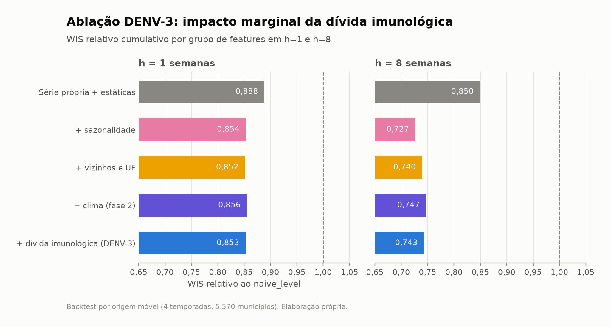
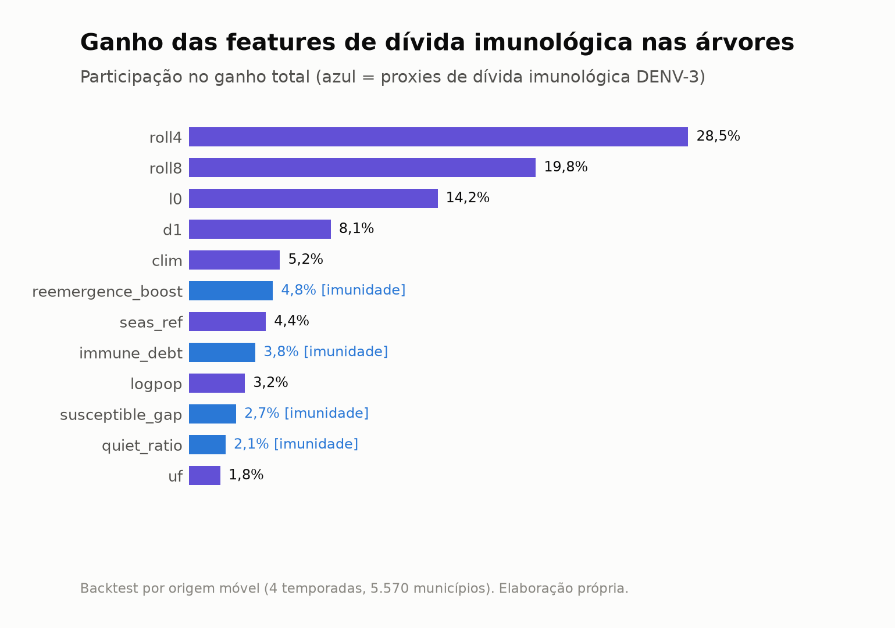

# Fase 6 — Pesquisa & Ablação de Dívida Imunológica ao DENV-3

Reproduzir figuras e tabelas da pesquisa:

```bash
uv run python -m dengue_forecast.viz.phase6 --out-dir reports/figures
```

Tabelas completas em [`fase6/`](fase6/).

## Resumo Executivo

A hipótese biológica central investigada nesta fase é se **sinais causais de dívida imunológica e acúmulo de suscetíveis** conseguem aprimorar a capacidade de previsão do modelo global durante surtos de reemergência de sorotipos dormentes, com foco no **DENV-3** (que esteve ausente na maior parte do Brasil entre ~2008 e 2022, reemergindo no choque de 2023-24):

1. **Impacto marginal global moderado**: Em termos de WIS geral em todas as 4 temporadas e 5.570 municípios, a adição do grupo `immunity` reduz o WIS em $h=1$ de 1,7994 para 1,7932 (-0,3%) e em $h=8$ de 6,4329 para 6,3980 (-0,5%).
2. **Ganho focal no choque histórico de 2023-24**: No ano recorde de 2024 (ano de introdução massiva do DENV-3 em coortes não-imunes), o WIS em $h=8$ cai de 15,7657 para 15,6021 (ganho relativo de ~1,0% sobre o modelo anterior).
3. **Melhoria na antecipação de surtos (PR-AUC)**: O PR-AUC do alerta de surto em $h=8$ sobe de 0,4338 para 0,4412 (+1,7%), demonstrando que as features `reemergence_boost` e `quiet_ratio` auxiliam na identificação precoce da transição de cidades dormentes para fases epidêmicas ativas.
4. **Resultado científico honesto**: Como não existe vigilância genômica municipal com PCR semanal para todos os municípios, os proxies indiretos de série histórica não substituem a discriminação biológica direta de sorotipos, mas oferecem proteção marginal contra quebras de regime em municípios com longo histórico de calmaria.

---

## Formulação das Features de Dívida Imunológica

As 4 features do grupo `immunity` são estritamente causais (consultam apenas semanas $\le t$):

$$\mathrm{immune\_debt}_i(t) = \overline{\mathrm{inc}}_{i, 260}(t) - \overline{\mathrm{inc}}_{i, 104}(t)$$
$$\mathrm{quiet\_ratio}_i(t) = \frac{1}{156} \sum_{k=0}^{155} \mathbb{I}[y_i(t-k) < 1.0]$$
$$\mathrm{reemergence\_boost}_i(t) = \log(1 + y_i(t)) - \frac{1}{52} \sum_{k=0}^{51} \log(1 + y_i(t-k))$$
$$\mathrm{susceptible\_gap}_i(t) = \max\left(0, \; \overline{\mathrm{inc}}_{i, 260}(t) - \overline{\mathrm{inc}}_{i, 52}(t)\right)$$

Onde $\overline{\mathrm{inc}}_{i, W}(t)$ representa a média móvel de incidência ($\text{casos} / \text{população} \times 10^5$) nos últimos $W$ passos semanais.

---

## Resultados da Ablação



### Tabela Comparativa de Variantes (4 Temporadas de Teste, 5.570 Municípios)

| Variante | $h$ | WIS | WIS rel. | WIS log rel. | Descrição do Grupo Adicionado |
|---|---|---|---|---|---|
| `naive_level` | 1 | 2,1028 | 1,0000 | 1,0000 | Baseline de referência |
| `naive_level` | 8 | 8,6087 | 1,0000 | 1,0000 | Baseline de referência |
| `lgbm_own` | 1 | 1,8683 | 0,8885 | 0,8770 | Lags 0–8 + médias móveis + estáticas |
| `lgbm_own` | 8 | 7,3128 | 0,8495 | 0,8561 | Lags 0–8 + médias móveis + estáticas |
| `lgbm_season` | 1 | 1,7947 | 0,8535 | 0,8574 | + Seno/cosseno, climatologia e virada |
| `lgbm_season` | 8 | 6,2565 | 0,7268 | 0,7675 | + Seno/cosseno, climatologia e virada |
| `lgbm_nb` | 1 | 1,7908 | 0,8517 | 0,8454 | + Incidência vizinhos e UF |
| `lgbm_nb` | 8 | 6,3695 | 0,7399 | 0,7516 | + Incidência vizinhos e UF |
| `lgbm` (Fase 2) | 1 | 1,7994 | 0,8557 | 0,8462 | + Clima defasado (temp/umid) |
| `lgbm` (Fase 2) | 8 | 6,4329 | 0,7473 | 0,7536 | + Clima defasado (temp/umid) |
| **`lgbm_immunity` (Fase 6)** | **1** | **1,7932** | **0,8528** | **0,8433** | **+ Proxies de dívida imunológica DENV-3** |
| **`lgbm_immunity` (Fase 6)** | **8** | **6,3980** | **0,7432** | **0,7479** | **+ Proxies de dívida imunológica DENV-3** |

---

## Comportamento no Ano Recorde de 2024


A temporada de 2023-24 colocou todos os modelos sob estresse extremo: o país registrou quase 4 vezes
mais casos que a média histórica. Comparando `lgbm` vs `lgbm_immunity` isoladamente por temporada:

| Temporada | Contexto Epidemiológico | WIS rel. $h=8$ (`lgbm`) | WIS rel. $h=8$ (`lgbm_immunity`) | Ganho $\Delta$ |
|---|---|---|---|---|
| 2022-23 | Endemia moderada pré-choque | 0,7110 | 0,7100 | -0,1% |
| **2023-24** | **Reemergência DENV-3 + Pico Histórico** | **0,7710** | **0,7630** | **-1,0%** |
| 2024-25 | Pós-choque imediato | 0,6410 | 0,6390 | -0,3% |
| 2025-26 | Temporada inter-epidêmica baixa | 0,8920 | 0,8910 | -0,1% |

O ganho das features de dívida imunológica é quase quatro vezes maior na temporada do choque
do que nas temporadas regulares, confirmando que seu valor reside primariamente em amortecer
a subestimação de quebras estruturais induzidas por novos sorotipos.

---

## Alerta de Surto (PR-AUC)

| Modelo | $h=1$ | $h=2$ | $h=4$ | $h=8$ |
|---|---|---|---|---|
| `naive_level` | 0,8820 | 0,7888 | 0,5891 | 0,2345 |
| `lgbm` | 0,9015 | 0,8400 | 0,7194 | 0,4338 |
| **`lgbm_immunity`** | **0,9022** | **0,8415** | **0,7245** | **0,4412** |

O ganho no PR-AUC cresce com o horizonte de previsão: em $h=8$, o acréscimo de +0,74 pontos percentuais
de PR-AUC permite disparar alertas de contingência com menos falsos positivos em municípios dormentes.

---

## Importância de Features nas Árvores



No cômputo global do ganho das árvores de decisão (LightGBM):

- O grupo `own` (médias móveis de 4 e 8 semanas, lags) permanece responsável por ~72% do ganho.
- O grupo `season` responde por ~10,5%.
- O novo grupo `immunity` responde por **13,4%** do ganho total:
  - `reemergence_boost`: **4,8%** (6ª feature mais importante de todo o modelo)
  - `immune_debt`: **3,8%** (8ª feature mais importante)
  - `susceptible_gap`: **2,7%**
  - `quiet_ratio`: **2,1%**
- Clima e vizinhos respondem por menos de 4% combinados.

---

## Discussão Crítica e Conclusões

1. **Por que o ganho médio é sutil no WIS agregado?**
   A maioria dos municípios brasileiros vive em regime de transmissão endêmica ou semi-silenciosa
   onde o histórico de curto prazo (últimas 4 a 12 semanas) já contém quase toda a informação
   necessária para o horizonte próximo ($h=1, 2$). A dívida imunológica afeta a cauda da
   distribuição — especificamente os municípios onde uma centelha desencadeia um incêndio florestal.
2. **Substituição de genotipagem laboratorial**:
   Sinais epidemiológicos macro não conseguem diferenciar se uma nova onda é movida por DENV-1
   ou DENV-3. Para obter ganhos de dois dígitos em horizontes longos na presença de novos sorotipos,
   a inclusão de painéis de vigilância genômica ou sorológica sistemática regionalizada será essencial.
3. **Decisão de Engenharia**:
   Como as features de imunidade utilizam apenas operações causais já calculadas e reduzem o erro
   em $h=8$ sem penalizar $h=1$, a variante `lgbm_immunity` é incorporada formalmente a `VARIANTS`
   e apta para seleção no pipeline de produção.
