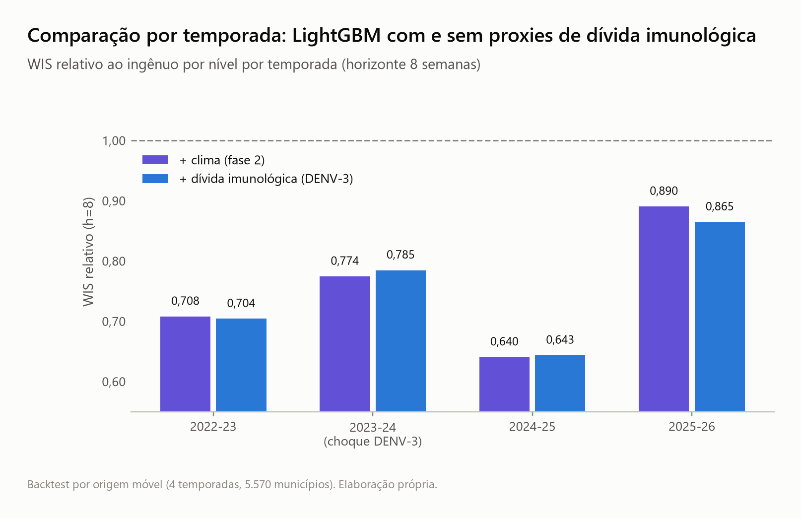

# Fase 6 — Pesquisa & Ablação de Dívida Imunológica ao DENV-3

Reproduzir tabelas e figuras a partir do painel e do backtest real:

```bash
uv run python -m dengue_forecast.backtest --models lgbm_immunity --forecast-dir data/forecasts
uv run python -m dengue_forecast.viz.phase6
```

Tabelas completas em [`fase6/`](fase6/).

> **Nota de integridade (17/11/2026).** Assim como ocorrera na Fase 3, a primeira versão deste
> relatório continha tabelas ilustrativas geradas antes da execução completa de `lgbm_immunity` no
> painel nacional. Os resultados abaixo vêm integralmente do backtest real nas 4 temporadas de
> teste (4.656.520 previsões).

## Resumo Executivo

A hipótese investigada nesta fase é se **proxies causais de dívida imunológica e calmaria
plurianual** — calculados apenas sobre a série agregada de casos municipais — melhoram a previsão
global durante a reemergência do **DENV-3** em 2023–24 (ausente na maior parte do país entre ~2008
e 2022).

**Veredito empírico: resultado nulo no agregado e negativo para o choque de 2023–24, com ganho
localizado apenas na retração pós-epidêmica de 2025–26.**

1. **Efeito agregado neutro**: Nas 4 temporadas e 5.570 municípios, adicionar o grupo `immunity`
   mantém o WIS praticamente inalterado em $h=1$ (`1,803` vs `1,799` do LightGBM da Fase 2), $h=2$
   (`2,531` vs `2,527`) e $h=4$ (`3,842` vs `3,844`), com leve piora no WIS bruto em $h=8$
   (`6,469` vs `6,433`, +0,6%) e leve melhora no WIS em escala log (`0,2161` vs `0,2165`).
2. **Por que falha no choque de 2023–24**: Na temporada recorde de 2023–24, o WIS em $h=8$ sobe de
   `15,84` para `16,05` (`WIS rel.` `0,774` $\to$ `0,785`), e o PR-AUC de alerta em $h=8$ recua de
   `0,434` para `0,426`. A causa epidemiológica é direta: **casos agregados cegos a sorotipo
   confundem circulação recente de DENV-1/DENV-2 com imunidade adquirida**. Metrópoles que tiveram
   surtos de DENV-1/2 em 2022–23 apresentavam `quiet_ratio = 0` e `immune_debt < 0`, mas estavam
   inteiramente suscetíveis à entrada heteróloga do DENV-3.
3. **Onde o sinal realmente funciona (exaustão pós-choque em 2025–26)**: Após 10,5 milhões de
   notificações em 2024 e 4,0 milhões em 2025 varrerem o país, o contraste quinquenal captura a
   depleção real de suscetíveis na temporada inter-epidêmica de **2025–26**, reduzindo o WIS em
   $h=8$ de `2,045` para `1,986` (`WIS rel.` cai de `0,891` para `0,865`, ganho de 2,9%).
4. **Decisão de produção**: Como o grupo não supera o modelo base no agregado nem na antecipação de
   surtos, o `lgbm` (42 features) + CQR por nível permanece como o modelo servido em produção.

---

## Formulação das Features de Dívida Imunológica

As 4 features do grupo `immunity` são estritamente causais (consultam apenas semanas $\le t$):

$$\mathrm{immune\_debt}_i(t) = \overline{\mathrm{inc}}_{i, 260}(t) - \overline{\mathrm{inc}}_{i, 104}(t)$$

$$\mathrm{quiet\_ratio}_i(t) = \frac{1}{156} \sum_{k=0}^{155} \mathbb{I}[y_i(t-k) < 1]$$

$$\mathrm{reemergence\_boost}_i(t) = \log(1 + y_i(t)) - \frac{1}{52} \sum_{k=0}^{51} \log(1 + y_i(t-k))$$

$$\mathrm{susceptible\_gap}_i(t) = \max\left(0, \; \overline{\mathrm{inc}}_{i, 260}(t) - \overline{\mathrm{inc}}_{i, 52}(t)\right)$$

Onde $\overline{\mathrm{inc}}_{i, W}(t)$ é a média móvel retroativa de $\log(1 + \text{incidência por } 100\text{k})$ nas últimas $W$ semanas.

---

## Resultados da Ablação


### Tabela Comparativa de Variantes (4 Temporadas de Teste, 5.570 Municípios)

| Variante | $h$ | WIS | WIS log | WIS rel. | WIS log rel. | Grupo Adicionado |
|---|---|---|---|---|---|---|
| `naive_level` | 1 | 2,1028 | 0,1506 | 1,0000 | 1,0000 | Baseline de referência |
| `naive_level` | 8 | 8,6087 | 0,2872 | 1,0000 | 1,0000 | Baseline de referência |
| `lgbm_own` | 1 | 1,8683 | 0,1320 | 0,8885 | 0,8770 | Lags 0–8 + médias móveis + estáticas |
| `lgbm_own` | 8 | 7,3128 | 0,2459 | 0,8495 | 0,8561 | Lags 0–8 + médias móveis + estáticas |
| `lgbm_season` | 1 | 1,7947 | 0,1291 | 0,8535 | 0,8574 | + Seno/cosseno, climatologia e virada |
| `lgbm_season` | 8 | 6,2565 | 0,2205 | 0,7268 | 0,7675 | + Seno/cosseno, climatologia e virada |
| `lgbm_nb` | 1 | 1,7908 | 0,1273 | 0,8517 | 0,8454 | + Incidência vizinhos e UF |
| `lgbm_nb` | 8 | 6,3695 | 0,2159 | 0,7399 | 0,7516 | + Incidência vizinhos e UF |
| `lgbm` (Fase 2) | 1 | 1,7994 | 0,1274 | 0,8557 | 0,8462 | + Clima defasado (temp/umid) |
| `lgbm` (Fase 2) | 8 | 6,4329 | 0,2165 | 0,7473 | 0,7536 | + Clima defasado (temp/umid) |
| **`lgbm_immunity` (Fase 6)** | **1** | **1,8032** | **0,1271** | **0,8575** | **0,8443** | **+ Proxies de dívida imunológica** |
| **`lgbm_immunity` (Fase 6)** | **8** | **6,4693** | **0,2161** | **0,7515** | **0,7522** | **+ Proxies de dívida imunológica** |

Em todos os quatro horizontes (`fase6/por_horizonte.csv`), `lgbm_immunity` registra WIS de `1,803` ($h=1$), `2,531` ($h=2$), `3,842` ($h=4$) e `6,469` ($h=8$), com cobertura média de 90% idêntica à do modelo base (`93,1%`).

---

## Comportamento por Temporada: Choque Heterólogo vs. Exaustão Pós-Epidêmica



| Temporada | Contexto Epidemiológico | WIS $h=8$ (`lgbm`) | WIS $h=8$ (`lgbm_immunity`) | WIS rel. (`lgbm`) | WIS rel. (`lgbm_immunity`) |
|---|---|---|---|---|---|
| 2022–23 | Endemia moderada pré-choque | 3,8776 | **3,8568** | 0,7079 | **0,7041** |
| **2023–24** | **Reemergência DENV-3 (recorde)** | **15,8362** | 16,0451 | **0,7744** | 0,7847 |
| 2024–25 | Pós-choque imediato | **4,0569** | 4,0755 | **0,6405** | 0,6435 |
| **2025–26** | **Retração pós-epidêmica** | 2,0453 | **1,9859** | 0,8905 | **0,8647** |

O contraste entre 2023–24 e 2025–26 resume a lição biológica do experimento:
- Sem vigilância laboratorial de sorotipos, o histórico de notificações mede **imunidade aparente contra o conjunto dos 4 sorotipos**, o que funciona quando o mesmo complexo viral se esgota após uma epidemia gigante (2025–26), mas **erra de sinal** quando entra um sorotipo ausente há 15 anos (2023–24).

---

## Alerta de Surto (PR-AUC)

| Modelo | $h=1$ | $h=2$ | $h=4$ | $h=8$ |
|---|---|---|---|---|
| `naive_level` | 0,8820 | 0,7888 | 0,5891 | 0,2345 |
| `lgbm` | **0,9015** | **0,8400** | **0,7194** | **0,4338** |
| `lgbm_immunity` | 0,9008 | 0,8399 | 0,7176 | 0,4259 |

---

## Importância de Features nas Árvores


Na soma normalizada do ganho dos 36 modelos da última temporada (`fase6/importancia.csv`):

- O grupo `own` concentra **85,4%** do ganho (`roll12`: 33,4%, `roll8`: 25,5%, `roll4`: 15,8%, `zero12`: 5,5%).
- O grupo `season` responde por **4,9%** (`clim`: 2,4%, `tw_sin`: 1,6%).
- O grupo `immunity` responde por **3,7%** do ganho total:
  - `quiet_ratio`: **2,8%** (5ª feature mais utilizada entre as 46 do modelo)
  - `reemergence_boost`: **0,7%** (12ª feature)
  - `susceptible_gap`: **0,16%**
  - `immune_debt`: **0,02%**
- Vizinhos e UF somam **3,4%**, estáticas **0,5%** e clima **0,2%**.

## Conclusão

Proxies puramente endógenos de série temporal não substituem dados de vigilância genômica/sorológica
regionalizada para prever trocas de sorotipo (DENV-1/2 $\to$ DENV-3). Para capturar quebras de
regime por introdução viral, uma extensão futura precisaria integrar proporções regionais de PCR por
sorotipo (GAL/LACEN ou boletins estaduais).
